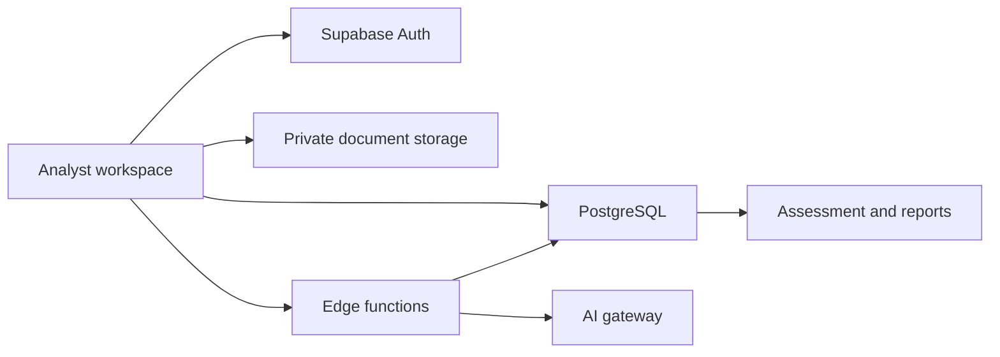

# Intelli-Credit

### From financial documents to an analyst-reviewed credit assessment.

[](https://github.com/jahwanthpulugujju-create/Intelli-Credit/actions/workflows/ci.yml)
[](LICENSE)


Intelli-Credit is an open-source credit intelligence workspace for company onboarding, financial-document review, risk analysis, and underwriting reports. It gives developers a starting point for building credit workflows and gives analysts a connected view of the evidence behind an assessment.

[Get started](#get-started) · [Architecture](docs/architecture.md) · [Contribute](CONTRIBUTING.md) · [Roadmap](docs/roadmap.md) · [Report an issue](https://github.com/jahwanthpulugujju-create/Intelli-Credit/issues)

## What you can build with it

- **An underwriting workspace:** company profiles, financing requests, and a document-to-report workflow.
- **A document review pipeline:** upload financial documents, review AI classification, and configure extraction fields.
- **A credit analysis interface:** financial signals, risk indicators, and five-Cs scoring views.
- **An assessment reporting tool:** analyst review and PDF export of generated reports.

The repository provides the client, database migrations, storage policies, and server-side analysis functions. AI-generated figures and research findings need verification against source evidence before a lending decision.

## How it fits together



React Router defines application workflows. TanStack Query coordinates client server state. Supabase supplies authentication, PostgreSQL, private document storage, and five Deno edge functions for classification, extraction, research, scoring, and reporting.

## Get started

**Requirements:** Node.js 22.13 or later, npm, and a Supabase project. AI workflows also require access to the current AI gateway.

```sh
git clone https://github.com/jahwanthpulugujju-create/Intelli-Credit.git
cd Intelli-Credit
npm ci
```

Set the two public client configuration values. In PowerShell:

```powershell
$env:VITE_SUPABASE_URL = "https://YOUR_PROJECT.supabase.co"
$env:VITE_SUPABASE_PUBLISHABLE_KEY = "YOUR_PUBLISHABLE_KEY"
npm run dev
```

In Bash:

```sh
export VITE_SUPABASE_URL="https://YOUR_PROJECT.supabase.co"
export VITE_SUPABASE_PUBLISHABLE_KEY="YOUR_PUBLISHABLE_KEY"
npm run dev
```

Open **http://localhost:8080**. Apply the backend migrations and configure the edge functions using the [development guide](docs/development.md). No environment files or working credentials are distributed in the repository.

**Just exploring the code?** Type checks, unit tests, lint, and the production build can run without a live backend:

```sh
npm run check
npm run lint
npm test
npm run build
```

Unit tests cover document selection limits and error handling. They do not replace authenticated, database-backed integration verification.

## Find your way around

- `src/pages/` — company, document, analysis, reporting, and administration workflows.
- `src/components/` — layouts, credit charts, document review, and UI primitives.
- `src/lib/` — shared utilities and validation tests.
- `src/integrations/supabase/` — typed client and generated database schema types.
- `supabase/functions/` — server-side analysis functions.
- `supabase/migrations/` — schema, access policies, and document storage setup.
- `docs/` — architecture, development, deployment, and contribution direction.

## Contribute

Fork the repository and read [CONTRIBUTING.md](CONTRIBUTING.md). Bug reports, regression tests, accessibility improvements, and clearer setup examples are welcome. For larger changes, open a feature proposal first. The [roadmap](docs/roadmap.md) identifies authorization, provider portability, provenance, and integration testing as useful next steps.

If the project is useful to you, a star helps other developers discover it. Share what you are building through an issue with a concrete use case.

## Deployment boundaries

This is a reference application, not a certified lending system. Edge-function platform JWT verification is currently disabled, and the existing document policies require deployment-specific authorization review. The current AI integration uses an external gateway. Do not process confidential financial information until access controls and integrations have been reviewed for your deployment.

See [Architecture](docs/architecture.md), [Deployment](docs/deployment.md), and [Security](SECURITY.md) for the current boundaries and reporting process.

## License

[MIT](LICENSE). You may use, modify, and distribute the project under the license terms. Retain the copyright and license notice; dependencies retain their own licenses.
